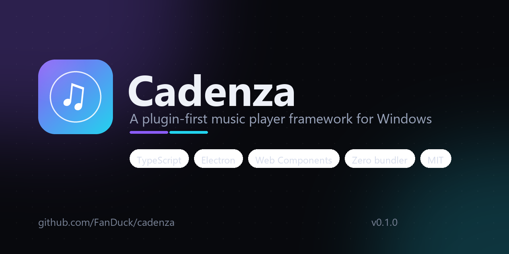

<div align="center">



# Cadenza

**面向 Windows 的、插件优先的音乐播放器框架。**

[](https://github.com/FanDuck/cadenza/actions/workflows/ci.yml)
[](LICENSE)
[](CHANGELOG.md)
[](#环境要求)

[快速开始](#快速开始) · [功能](#功能) · [写第一个插件](#写第一个插件) · [English](README.md)

</div>

---

Cadenza 同时是两样东西：

1. **一个框架。** `@fanduck/cadenza-core` 是与界面无关的引擎 —— 播放队列、播放状态机、
   音乐库、标签解析、歌词、歌单，以及插件宿主。它不依赖 DOM、不依赖 Electron、不依赖任何
   UI 框架。你可以把它嵌进自己的程序，做出你想要的播放器。
2. **一个播放器。** `apps/desktop` 是基于该引擎的完整 Windows 桌面播放器：既是参考实现，
   也证明这套框架足以交付一个真正好用的产品。

大多数播放器是封闭的黑盒，Cadenza 生来就是要被打开的：插件拥有和内建界面同等的能力，
而界面本身也可以被替换。

## 功能

**播放**
- 支持 MP3、FLAC、WAV、M4A/M4B（AAC 与 ALAC）、Ogg Vorbis、Opus，并完整读取标签；
  AIFF 与 WMA 可被扫描、在编解码器可用时也能播放，但暂不解析其标签
- 随机播放、单曲/列表循环、键盘拖动进度、音量、静音
- 多媒体按键、Windows 任务栏进度条与缩略图工具栏按钮
- 退出后恢复队列、音量、随机与循环模式

**音乐库**
- 主进程递归扫描文件夹，界面永不卡顿
- 从零手写的标签解析（无原生依赖）：ID3v2.2/2.3/2.4、Vorbis 注释、MP4 atoms、RIFF/WAVE，
  并提取、缓存内嵌封面
- 忽略变音符号的搜索（标题 / 艺术家 / 专辑 / 路径）
- 专辑视图、艺术家视图、排序与筛选

**更多**
- `.lrc` 侧载歌词，逐行高亮，点击跳转
- M3U / M3U8 / PLS 导入，M3U 导出
- 命令面板（`Ctrl+K`），插件可扩展
- 频谱可视化
- 三套内置主题与基于设计令牌的主题 API

**面向开发者**
- 零打包器：只用 `tsc` 和原生 ES Modules
- 9 个 `<cz-*>` Web Components，Shadow DOM + 键盘可达 + ARIA
- 插件 API：UI 插槽、命令、播放器/音乐库门面、独立设置、主题变量
- 核心 93+ 个单元测试，`node --test` 直接运行

## 环境要求

- Windows 10 / 11（桌面端基于 Electron；核心同样可运行在浏览器）
- [Node.js](https://nodejs.org) 20+ 与 [pnpm](https://pnpm.io) 9+

## 快速开始

```powershell
git clone https://github.com/FanDuck/cadenza.git
cd cadenza
pnpm install
pnpm start
```

`pnpm start` 会先编译再打开播放器。点击 **添加音乐文件夹**，选择你的音乐目录，然后按播放。

还没装 Node？到 [nodejs.org](https://nodejs.org) 下载 LTS 版本，然后执行
`npm install -g pnpm`，工具链就齐了。

### 不装任何东西，先在浏览器里看看

```powershell
pnpm demo
```

用示例数据在浏览器里打开同一套界面，不读取本地音频、不需要 Electron。

### 截图

```powershell
pnpm screenshot
```

从真实运行的窗口保存 `screenshots/app.png`（README 里的截图就是这样生成的）。

## 写第一个插件

在 `%APPDATA%\Cadenza\plugins\my-plugin\` 下新建两个文件：

```json
// cadenza.plugin.json
{
  "id": "my-plugin",
  "name": "My Plugin",
  "version": "0.1.0",
  "main": "index.js",
  "cadenza": "^0.1.0"
}
```

```js
// index.js
export default {
  activate(ctx) {
    ctx.commands.register({
      id: "my-plugin.greet",
      title: "打个招呼",
      run() {
        const track = ctx.player.snapshot().track;
        ctx.log(track ? `正在播放：${track.title}` : "当前没有播放");
      },
    });
  },
};
```

打开 **设置 → 插件 → 重新加载插件**。无需编译、无需依赖。

完整示例见 [`examples/plugins`](examples/plugins)，接口参考
[docs/PLUGIN_API.md](docs/PLUGIN_API.md)。

## 只用核心，做你自己的播放器

```ts
import { HtmlAudioSink, Player } from "@fanduck/cadenza-core";

const player = new Player(new HtmlAudioSink());
player.bus.on("player:snapshot", (s) => {
  console.log(s.track?.title, s.position, s.duration);
});
player.enqueue(tracks);
await player.play();
```

把 `HtmlAudioSink` 换成你自己的 `AudioSink`（WebAudio、网络流、DAW），队列、
随机/循环、状态机都照常工作。详见 [docs/EMBEDDING.md](docs/EMBEDDING.md)。

## 主题

所有颜色都是 CSS 自定义属性，一个主题就是一份覆盖值：

```json
{
  "id": "my-theme",
  "name": "我的主题",
  "vars": {
    "--cz-bg": "#0b0b14",
    "--cz-accent": "#ff7ac6",
    "--cz-grad": "linear-gradient(135deg,#ff7ac6,#7c5cff)"
  }
}
```

内置 **Midnight**（默认）、**Daylight**、**Synthwave**。详见 [docs/THEMING.md](docs/THEMING.md)。

## 快捷键

| 按键 | 作用 |
| --- | --- |
| `空格` | 播放 / 暂停 |
| `←` / `→` | 后退 / 前进 5 秒 |
| `Ctrl+←` / `Ctrl+→` | 上一首 / 下一首 |
| `↑` / `↓` | 音量 |
| `M` | 静音 |
| `S` | 随机播放 |
| `R` | 切换循环模式 |
| `Ctrl+F` | 搜索 |
| `Ctrl+K` | 命令面板 |
| `Ctrl+Q` | 队列面板 |
| `Esc` | 关闭浮层 |

## 目录结构

```
packages/core     引擎：队列、播放器、音乐库、标签、歌词、歌单、插件
packages/ui       <cz-*> Web Components 与主题令牌
apps/desktop      Electron 主进程 + preload + 参考界面
examples/         示例插件
docs/             架构、插件 API、主题、嵌入、路线图
scripts/          构建（直接调用 tsc，无打包器）、演示服务器、素材生成
```

## 文档

| 文档 | 内容 |
| --- | --- |
| [ARCHITECTURE.md](docs/ARCHITECTURE.md) | 各模块如何协作，以及维持边界的规则 |
| [PLUGIN_API.md](docs/PLUGIN_API.md) | 清单、上下文、插槽、命令、生命周期 |
| [THEMING.md](docs/THEMING.md) | 令牌清单、主题文件、运行时覆盖 |
| [EMBEDDING.md](docs/EMBEDDING.md) | 在自己的程序里使用核心 |
| [ROADMAP.md](docs/ROADMAP.md) | 后续计划 |
| [CONTRIBUTING.md](CONTRIBUTING.md) | 开发环境与提交规范 |

## 状态

**0.1.0 —— 可用，但仍在 1.0 之前。** 播放、音乐库、歌词、歌单、主题与插件 API 均已可用。
安装包是下一个里程碑，目前请从源码运行。`0.x` 期间次版本可能调整插件 API，
破坏性变更会在 [CHANGELOG](CHANGELOG.md) 中给出迁移说明。

## 参与贡献

欢迎提交 issue、插件想法和 PR —— 尤其欢迎刚学编程的朋友。请先阅读
[CONTRIBUTING.md](CONTRIBUTING.md)，并遵守 [CODE_OF_CONDUCT.md](CODE_OF_CONDUCT.md)。

安全问题请走 [SECURITY.md](SECURITY.md)。

## 许可证

[MIT](LICENSE) © 2026 FanDuck
